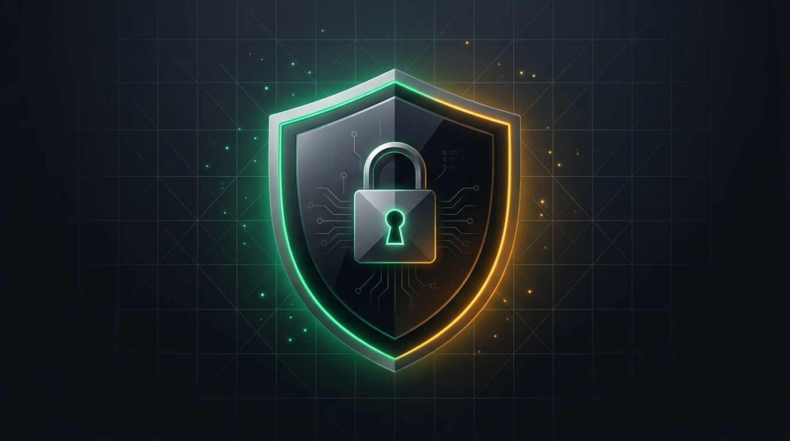
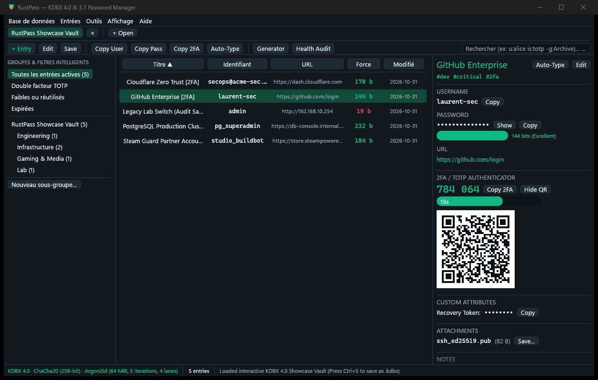
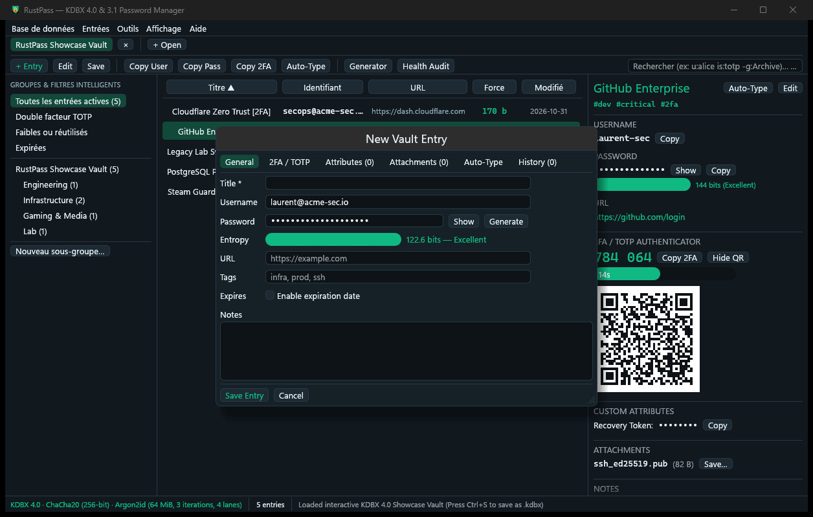
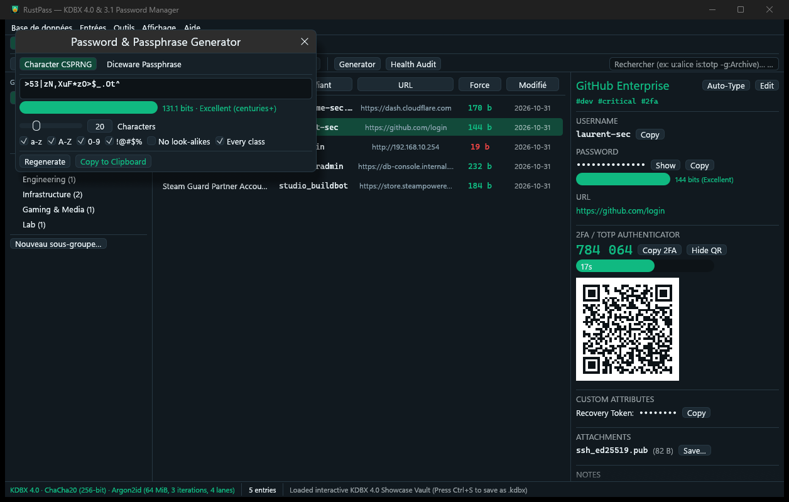
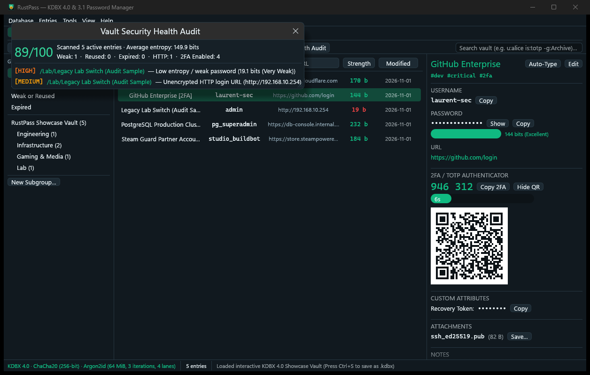
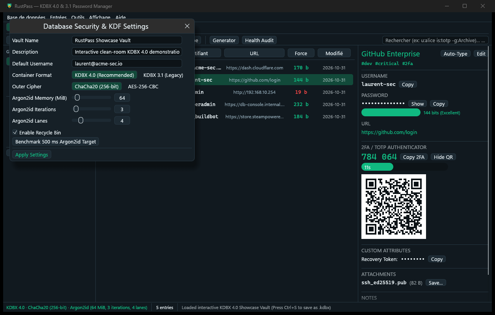

<div align="center">



# RustPass

### Modern, High-Performance & Memory-Safe Password Manager in Pure Rust

[](https://www.rust-lang.org/)
[](LICENSE)
[](https://keepass.info/)
[](https://github.com/rust-lang/rust-clippy)
[](cargo-test)
[](https://crates.io/crates/zeroize)
[](https://github.com/laurentvv/RustPass)

<p align="center">
  <b>A modern, high-performance desktop password manager, scriptable CLI, and browser integration built in pure Rust.</b><br>
  Engineered with memory safety, hardware-accelerated cryptography, zero plaintext secret leakage, and native support for industry-standard KDBX vault files.
</p>

[Key Features](#key-features) •
[Interface](#interface-showcase) •
[Architecture](#security--cryptography-architecture) •
[Installation](#installation--build) •
[CLI Cheatsheet](#cli-cheatsheet-rustpass-cli) •
[Browser Integration](#browser-integration-rustpass-proxy) •
[License](#license)

</div>

---

## Overview

**RustPass** is an independent, pure Rust password management suite designed for security, velocity, and ergonomic daily workflows. Built with modern cryptographic guarantees, it offers a GPU-accelerated desktop application, an exhaustive automation CLI, and a high-throughput browser proxy.

### Why RustPass?

- 🛡️ **Zero Secret Leakage:** Master keys, intermediate KDF states, composite credentials, and decrypted secrets are wrapped in `zeroize::Zeroizing` buffers that are deterministically scrubbed from memory immediately upon drop or database locking.
- ⚡ **Native GPU Desktop Experience:** Built on `egui`/`eframe` 0.37 with instant keyboard-first workflows, sub-millisecond search queries, multi-vault tabs, live RFC 6238 TOTP clocks with scannable QR codes, and 7 themes with automatic OS dark/light mode following.
- 📂 **Standard KDBX Vault Compatibility:** Natively opens, edits, and creates standard `.kdbx` (v4.1, v4.0, and v3.1) database files. Seamlessly read and write your existing vaults with Argon2id, ChaCha20, and AES-KDF.
- 💾 **Crash-Proof Atomic Saves:** Vault modifications are always written to an isolated `.kdbx.tmp` file and atomically renamed over the destination path to prevent file corruption in case of power interruption or disk failure.
- 🌍 **Bilingual by Design:** English by default, with instant runtime switching between English and French (FR/EN).
- 🚀 **Lean Single-File Binaries:** Zero external runtime dependencies. Self-contained release binaries (1.5 MB – 11 MB) compiled with Thin-LTO and stripped debug symbols.

---

## Interface Showcase

<div align="center">

### Main Vault Workspace (3-Pane Layout)
*Real-time group hierarchy, structured search grammar, entry details, live TOTP countdown, and scannable QR code preview.*



<br/><br/>

| **Comprehensive Entry Editor** | **CSPRNG & Diceware Generator** |
|:---:|:---:|
|  |  |
| *6 tabs: Entry, Advanced, TOTP, History, Auto-Type, Properties.* | *Configurable character sets, EFF Diceware passphrases, entropy meter.* |

<br/>

| **Security Health Audit** | **Database Security Settings** |
|:---:|:---:|
|  |  |
| *Calculates health score (0-100), scans weak, reused, or expired entries.* | *Configure Argon2id, Argon2d, AES-KDF, ChaCha20, or AES-256-CBC.* |

</div>

---

## Suite Components

| Binary | Role | Description |
| :--- | :--- | :--- |
| **`rustpass.exe`** | Desktop GUI | GPU-accelerated desktop password manager with multi-vault tabs, command palette (`Ctrl+Shift+P`), and live TOTP clock. |
| **`rustpass-cli.exe`** | Automation CLI | Full-featured 25-subcommand CLI for scripting, headless servers, and terminal workflows. |
| **`rustpass-proxy.exe`** | Browser Proxy | High-throughput `u32 LE` JSON stdio Native Messaging host for browser auto-fill integration. |

---

## Key Features

### 🔐 Cryptography & Vault Formats
- **Standard KDBX Format:** Full support for KDBX v4.1, v4.0, and v3.1 vault files.
- **Key Derivation Functions (KDF):**
  - **Argon2id & Argon2d** with configurable memory cost, iterations, and lanes.
  - Hardware-accelerated **AES-KDF** for backward and cross-platform compatibility.
- **Ciphers & Block Stream Integrity:**
  - **ChaCha20** (256-bit, RFC 8439) with HMAC-SHA-256 block stream authentication.
  - **AES-256-CBC** with PKCS#7 padding and HMAC-SHA-256 verification.
  - Inner stream protection using **ChaCha20** or **Salsa20** for memory-sensitive attributes and binary attachments.
- **Flexible Credentials:**
  - Master Passwords.
  - XML v2.0 `.keyx` Key Files (with 4-byte SHA-256 integrity hash), XML v1.0, 64-hex strings, and 32-byte raw binary files.
  - Composite credentials combining passwords and key files.

### ⏱️ Two-Factor Authentication (TOTP & Steam Guard)
- **RFC 6238 & RFC 4226:** HMAC-SHA1, HMAC-SHA256, and HMAC-SHA512 algorithms.
- **Custom Parameters:** 6 to 10 digits and custom time steps (10s, 30s, 60s); counter-based HOTP URIs are rejected with an explicit error (not silently mistreated).
- **Steam Guard:** Alphanumeric 5-character token generation.
- **Integrated QR Code Generator:** Pure-Rust ISO/IEC 18004 QR encoder rendering scannable `otpauth://` matrices in the GUI (per-entry textures — no cross-tab leakage).

### 🛡️ Security Health Audit & Password Generation
- **Automated Vault Audit:** Evaluates password strength, flags reused/duplicate passwords, identifies expired or near-expiry credentials, detects insecure HTTP URLs, and alerts on entries lacking 2FA — including offline HIBP breach checking.
- **Exportable Reports:** One-click CSV and styled HTML audit reports from the GUI or `rustpass-cli analyze --export-csv/--export-html` (reports never contain passwords).
- **Dual Password Generators:**
  - **CSPRNG Generator:** Cryptographically secure unbiased rejection sampling with custom character sets (upper, lower, digits, special, extended, exclude lookalike characters).
  - **EFF Diceware Passphrases:** The official **EFF large wordlist (7 776 words) is embedded** — strong passphrases out of the box, with custom delimiters (`-`, `.`, `_`, space) and title casing.

### 💻 Desktop Experience & Ergonomics
- **Command Palette:** Instant quick navigation with `Ctrl+Shift+P` to switch groups, trigger audit, or generate credentials.
- **Structured Search Grammar:** Filter with syntax like `u:alice is:totp -g:Archive | t:GitHub` (with regex mode via `*pattern`).
- **Recycle Bin Management:** Per-entry and bulk **Restore / Empty Trash** from the sidebar and inspector.
- **Group Management:** Rename and delete groups (with tombstoned subtree semantics safe for merges) directly from the sidebar.
- **Auto-Type Integration:** Windows `SendInput` Unicode keystroke emulation (`Ctrl+V`) with real `{CLEARFIELD}` support and strict placeholder validation.
- **Timed Clipboard Clearing:** Configurable clipboard clearing timer (default 12s) with active countdown — a newer copy is never wiped.
- **Idle Auto-Lock:** Unlocked vaults lock after configurable inactivity, saving unsaved edits first; every close path (tab ×, `Ctrl+N/W/Q`, menus) confirms before discarding unsaved changes.
- **Bilingual Interface:** English by default, with instant runtime switching to French — toolbar, inspector, welcome/lock screens and all modals included.

---

## Security & Cryptography Architecture

```
[ Master Password ] + [ Key File (.keyx) ]
          │
          ▼
   [ Composite Key ] (zeroize::Zeroizing)
          │
          ▼
   [ KDF: Argon2id / Argon2d / AES-KDF ] ──► Derived Master Key
          │
          ▼
   [ Outer Cipher: ChaCha20 / AES-256-CBC ]
          │
          ▼
   [ HMAC-SHA-256 Block Stream ] ──► Authenticated Payload
          │
          ▼
   [ Inner Decrypted XML DOM ]
     ├─ Protected Attributes (<Value Protected="True">) ──► ChaCha20/Salsa20 Inner Stream
     ├─ Binary Attachments (Base64 / GZip / Raw) ────────► In-Memory Zeroized Decryption
     └─ Version History Snapshots ───────────────────────► Automatic Diff History
```

---

## Installation & Build

### Prerequisites
- **Rust:** Rust 1.85+ (Edition 2024).
- **Cargo:** Bundled with Rust toolchain.
- **Platform:** Windows 10/11, Linux (X11/Wayland), macOS 12+.

### Build from Source

```bash
# Clone the repository
git clone https://github.com/laurentvv/RustPass.git
cd RustPass

# Run static analysis and clippy checks
cargo fmt --check
cargo clippy --all-targets -- -D warnings

# Execute test suite (23 unit and integration tests)
cargo test

# Build optimized release binaries
cargo build --release
```

Release binaries will be generated in `target/release/`:
- `rustpass.exe`
- `rustpass-cli.exe`
- `rustpass-proxy.exe`

---

## CLI Cheatsheet (`rustpass-cli`)

`rustpass-cli` provides 25 scriptable subcommands for automated vault operations:

```powershell
# 1. Create a new KDBX v4.1 vault with Argon2id and a generated XML v2.0 keyfile
rustpass-cli db-create -p --set-key-file vault.keyx -t 500 vault.kdbx

# 2. Add an entry with custom URL, notes, and a generated 24-character password
rustpass-cli add -k vault.keyx -u alice --url https://github.com -g -L 24 vault.kdbx Development/GitHub

# 3. Add an entry with an RFC 6238 TOTP seed
rustpass-cli add -k vault.keyx -u bob --totp JBSWY3DPEHPK3PXP vault.kdbx Services/AWS

# 4. Show decrypted password or print the live 6-digit TOTP token
rustpass-cli show -s -k vault.keyx vault.kdbx Development/GitHub
rustpass-cli show -t -k vault.keyx vault.kdbx Services/AWS

# 5. Copy credentials directly to system clipboard
rustpass-cli clip -k vault.keyx vault.kdbx Development/GitHub

# 6. Generate Diceware passphrases (5 words, hyphen separator)
rustpass-cli diceware -W 5 -d "-"

# 7. Run a complete Security Health Audit on the vault
rustpass-cli analyze -k vault.keyx vault.kdbx

# 8. Merge two databases together
rustpass-cli merge --same-credentials -k vault.keyx target.kdbx source.kdbx

# 9. Export or import entries in CSV / XML formats
rustpass-cli export -k vault.keyx -f csv vault.kdbx backup.csv
rustpass-cli import -f csv backup.csv imported.kdbx
```

---

## Browser Integration (`rustpass-proxy`)

`rustpass-proxy` is a native messaging host communicating over standard input/output using length-prefixed `u32 LE` JSON packets:

1. **Manifest Generation:**
   `rustpass-proxy --print-chromium-manifest` prints a ready-to-register manifest (register it under `HKCU\Software\Google\Chrome\NativeMessagingHosts\org.keepassxc.keepassxc_browser`).
2. **Encrypted Channel (KeePassXC-Browser v7 protocol):**
   `change-public-keys` performs a real X25519 key exchange (ephemeral server keypair per process, via `crypto_box`/NaCl box), and every later action — `associate`, `test-associate`, `get-databasehash`, `generate-password`, **`get-logins`** — travels inside a NaCl box (`base64(nonce || box(json))`, response nonce = client nonce + 1). Credentials are only ever emitted encrypted. Associations (id → idKey) are stored for the proxy process lifetime; plaintext responses require the explicit `RUSTPASS_ALLOW_PLAINTEXT_LOGINS=1` test opt-in (loudly warned on stderr).

---

## Verification & Testing

- **KDBX Format Interoperability:**
  Cross-binary tests verify round-trip integrity for standard KDBX 4.1, 4.0, and 3.1 databases.
- **Automated GUI Test Suite:**
  7 comprehensive headless GUI workflow tests validate database creation, nested group tree mutations, 6-tab entry editor modifications, live TOTP ticks, Diceware generators, and session locking.
- **Zeroize Memory Verification:**
  Secret buffers implement `zeroize::ZeroizeOnDrop` ensuring deterministic memory erasure.

---

## Project Structure

```
RustPass/
├── assets/                  # Application icons, manifest, and screenshots
│   ├── banner.png           # Hero header illustration
│   ├── icon.ico             # Multi-resolution procedural icon (16-256px)
│   └── screenshots/         # Verified GUI interface captures
├── src/
│   ├── app.rs               # egui/eframe 0.37 desktop application loop
│   ├── audit.rs             # Security health audit scanner
│   ├── autotype.rs          # Unicode Auto-Type sequence parser
│   ├── cli.rs               # 25-subcommand CLI router & argument parsing
│   ├── crypto/              # Argon2id, AES, ChaCha20, and XML v2.0 KeyFiles
│   ├── generator.rs         # CSPRNG & EFF Diceware passphrase generators
│   ├── io.rs                # CSV & XML import/export engines
│   ├── kdbx/                # KDBX 3.1 & 4.1 parsers, serializers, and block streams
│   ├── proxy.rs             # Browser Native Messaging host
│   ├── search.rs            # Structured search query parser
│   ├── totp/                # RFC 6238 TOTP, Steam Guard & QR code encoder
│   └── ui/                  # 3-pane layout, modals, command palette, themes
└── tests/
    └── cli_integration.rs   # Cross-binary integration test suite
```

---

## License

This project is licensed under the **MIT License** — see the [LICENSE](LICENSE) file for details.
